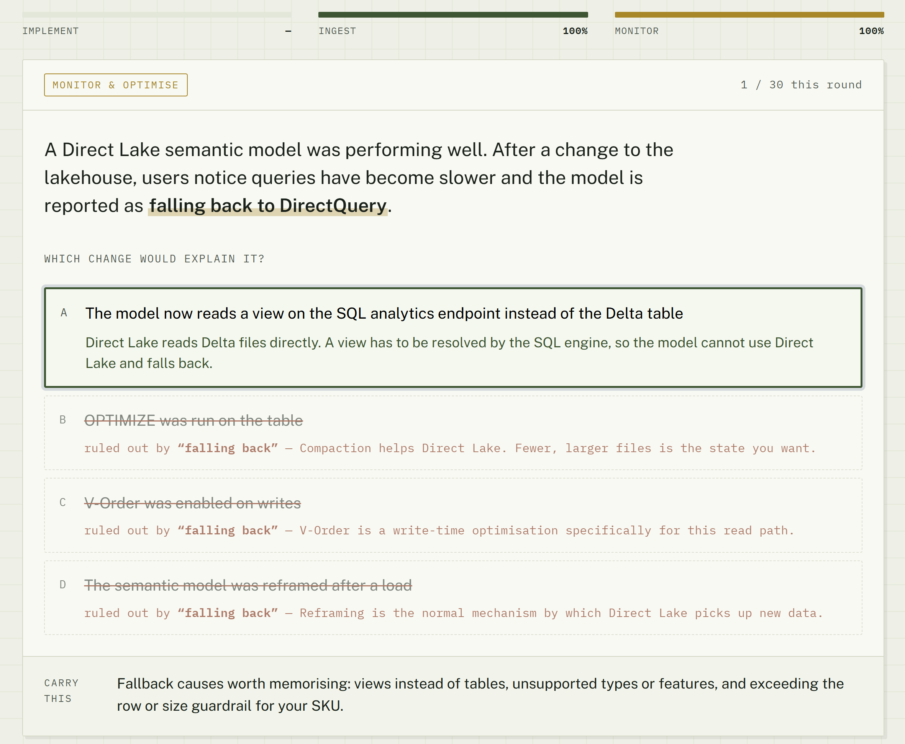
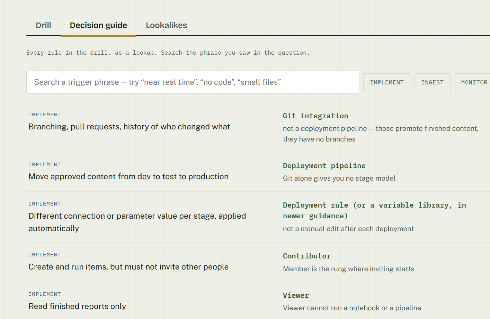
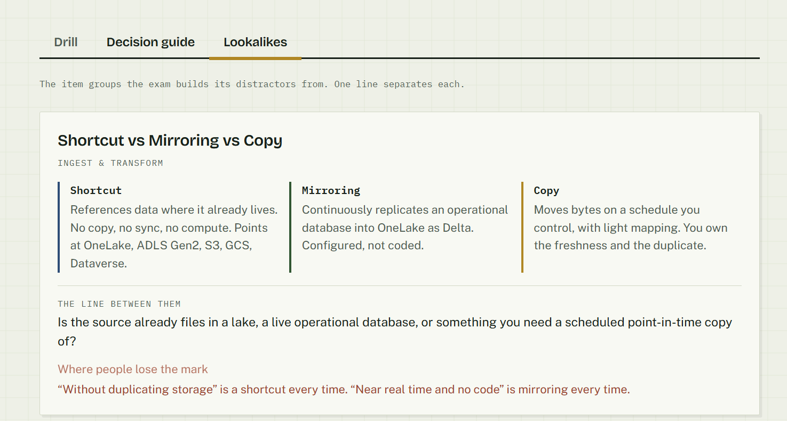

# Fabric Decision Desk — DP-700

A scenario drill for **Exam DP-700: Implementing Data Engineering Solutions Using Microsoft Fabric**.

**Live:** https://ailinnesse.github.io/dp700-decision-desk/

## Why this exists

DP-700 rarely asks what a Fabric item *is*. It gives you four items that all nearly work, and one clause in the scenario that rules three of them out. Shortcut or mirroring. Lakehouse or warehouse. OPTIMIZE or VACUUM. Retention or caching. Most study tools test the definition. The exam tests the discrimination.

So this drills the clause, not the definition. Answer a scenario and every wrong option is struck through with the exact phrase from the stem that killed it.

## Three modes

| Mode | What it does |
|---|---|
| **Drill** | One scenario at a time. On answering, the trigger phrases in the stem light up and each distractor shows the clause that ruled it out. Accuracy tracked per exam domain. |
| **Decision guide** | Every rule as a searchable lookup — search the phrase you saw in the question. |
| **Lookalikes** | The item groups the exam builds its distractors from, with the one line that separates each. |

Content: 30 scenarios, 58 decision rules, 12 lookalike groups, balanced across the three exam domains.







## Run it

It is one file with no build step and no dependencies.

```bash
open index.html          # or just double-click it
```

To host it: push to a repo, enable GitHub Pages on the default branch, done. It also drops straight into a Fabric App as the static frontend.

## Add your own

All content lives in one `DATA` block at the top of the `<script>` — three arrays, no other code to touch. `d` is the domain: `1` implement and manage, `2` ingest and transform, `3` monitor and optimise.

```js
{d:2,
 stem:"…the scenario…",
 trig:["the phrase that decides it"],     // highlighted after answering
 ask:"What do you set up?",
 opts:[
  {t:"The right item", ok:true, why:"why it wins"},
  {t:"A lookalike",    kill:"phrase from the stem", note:"why that phrase kills it"}
 ],
 take:"the rule to carry into the exam"}
```

The most useful thing you can do with a fork is add the questions **you** got wrong. A miss you have written up as a trigger phrase is worth ten cards you already knew.

## Accuracy

Every scenario is invented — no real data, no exam material. The rules are written from public Microsoft Learn documentation and the DP-700 skills-measured outline.

I haven't yet verified every rule against a full DP-700 study cycle — corrections via issues or PRs are welcome.

Fabric ships changes monthly and the skills-measured document is revised a few times a year. **Check anything here against the [official DP-700 study guide](https://learn.microsoft.com/en-gb/credentials/certifications/resources/study-guides/dp-700) before you trust it on exam day.**

## Licence

MIT. Take it, fork it, point it at DP-600 or DP-900.
